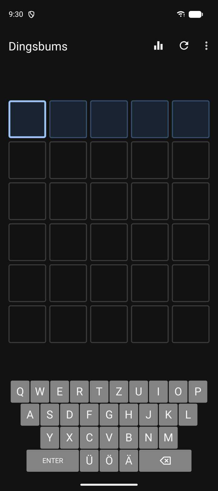
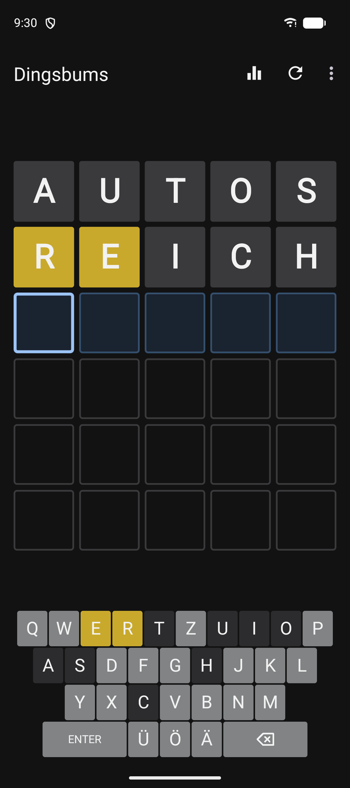
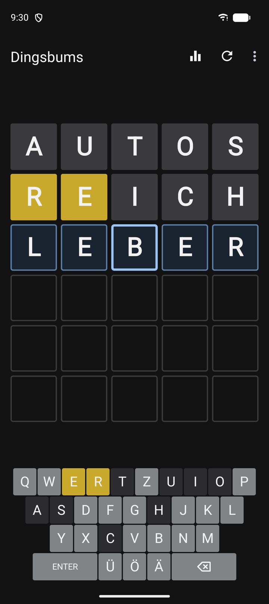
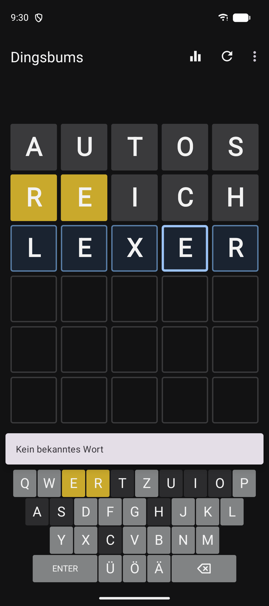
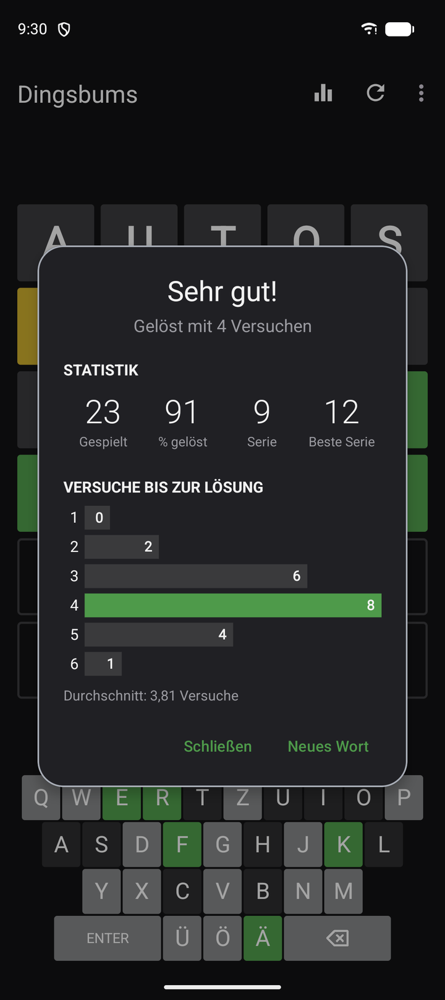
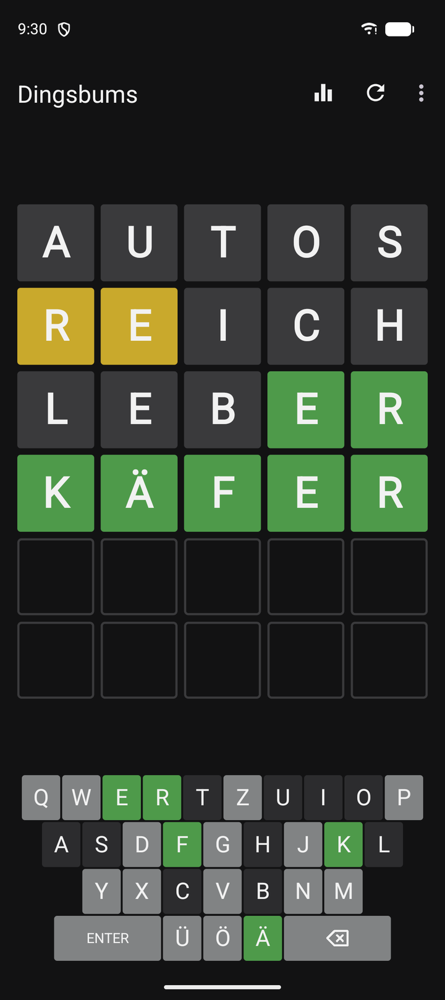
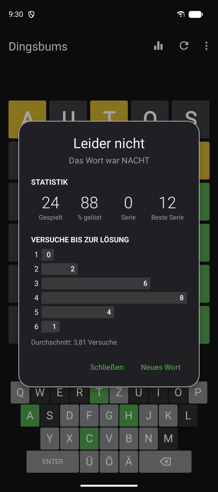
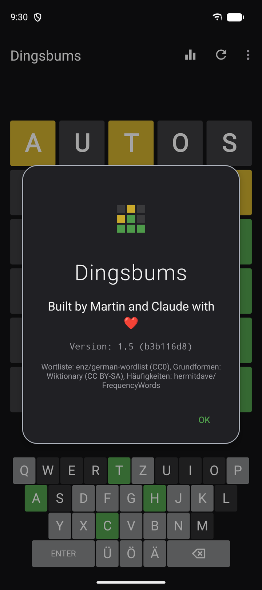

# Wörter raten als App

**Dingsbums** ist ein Worträtsel für Android nach dem Vorbild von Wordle: Gesucht wird ein deutsches
Wort mit fünf Buchstaben, sechs Versuche hat man. Entstanden ist die App für den Hausgebrauch, für
Erwachsene und für Kinder, die schon sicher lesen und schreiben, auf dem Handy und auf dem
Kinder-Tablet. Nebenbei übt sie Rechtschreibung und Wortschatz.

## So funktioniert's

Ein beliebiges Wort mit fünf Buchstaben eintippen und mit **ENTER** abschicken. Danach klappen die
Felder um und verraten, wie nah man dran ist:

| Farbe | Bedeutung |
|---|---|
| **grün** | Der Buchstabe steht an der richtigen Stelle. |
| **gelb** | Der Buchstabe kommt im Wort vor, aber an einer anderen Stelle. |
| **grau** | Der Buchstabe kommt nicht (oder nicht so oft) vor. |

Die Bildschirmtastatur färbt sich mit, so sieht man auf einen Blick, welche Buchstaben schon
ausgeschlossen sind. Wörter, die es nicht gibt, lehnt die App ab, ohne dass ein Versuch verloren
geht.

<table>
<tr>
<td width="50%"></td>
<td width="50%"></td>
</tr>
<tr>
<td><b>Start:</b> sechs Zeilen zu fünf Feldern; die blaue Zeile ist dran, der helle Rahmen zeigt,
wo der nächste Buchstabe landet.</td>
<td><b>Schneller Einstieg:</b> Doppeltipp auf die zweite Zeile trägt die Startwörter AUTOS und
REICH ein.</td>
</tr>
<tr>
<td width="50%"></td>
<td width="50%"></td>
</tr>
<tr>
<td><b>Korrigieren:</b> Ein Feld antippen und einfach überschreiben, ohne alles zu löschen.</td>
<td><b>Kein Wort:</b> Erfundene Wörter werden abgelehnt und kosten keinen Versuch.</td>
</tr>
<tr>
<td width="50%"></td>
<td width="50%"></td>
</tr>
<tr>
<td><b>Gelöst:</b> Statistik mit Serie und der Verteilung der Versuche, die aktuelle Runde ist
hervorgehoben.</td>
<td><b>Spielfeld:</b> Umlaute haben eigene Tasten und zählen als eigene Buchstaben.</td>
</tr>
<tr>
<td width="50%"></td>
<td width="50%"></td>
</tr>
<tr>
<td><b>Nicht gelöst:</b> Nach sechs Versuchen verrät die App das Wort.</td>
<td><b>Über die App:</b> welche Version installiert ist und woher die Wörter kommen.</td>
</tr>
</table>

## Kleine Details

- **Kindgerechte Wörter:** Gesucht werden nur gebräuchliche Grundformen (BLUME, nicht BLUMEN).
  Namen, englische Wörter, Schimpfwörter und Wörter rund um Sex, Drogen, Gewalt oder schwere
  Krankheiten kommen als Lösung nicht vor.
- **Ehrliche Statistik:** Wer mitten in einer Runde ein neues Wort anfängt, gibt auf, und die Runde
  zählt als nicht gelöst. Ohne einen einzigen Versuch zählt sie nicht.
- **Nichts geht verloren:** Die laufende Runde übersteht das Schließen der App, Statistik und Runde
  überstehen Updates. Die Statistik lässt sich als Datei exportieren und auf einem neuen Gerät wieder
  importieren.
- **Kein Wort doppelt:** Die letzten 200 Lösungen kommen nicht gleich wieder dran.
- **Ohne Konto und Werbung:** Gespeichert wird nur auf dem Gerät. Ins Internet geht die App nur, um
  nach einer neuen Version zu sehen.

## Ausprobieren

Auf einem Android-Gerät (ab Version 8) die APK-Datei vom
[neuesten Release](https://github.com/hansmaulwurf23/dingsbums/releases/latest) herunterladen und
öffnen. Android fragt einmal, ob Apps aus dieser Quelle installiert werden dürfen, und warnt
eventuell, weil die App nicht aus dem Play Store kommt; beides lässt sich bestätigen. Auf einem
Amazon-Fire-Kids-Tablet im Eltern-Profil installieren und die App dann für das Kinderprofil
freigeben. Neue Versionen meldet die App selbst. Für iPhones gibt es die App nicht.
